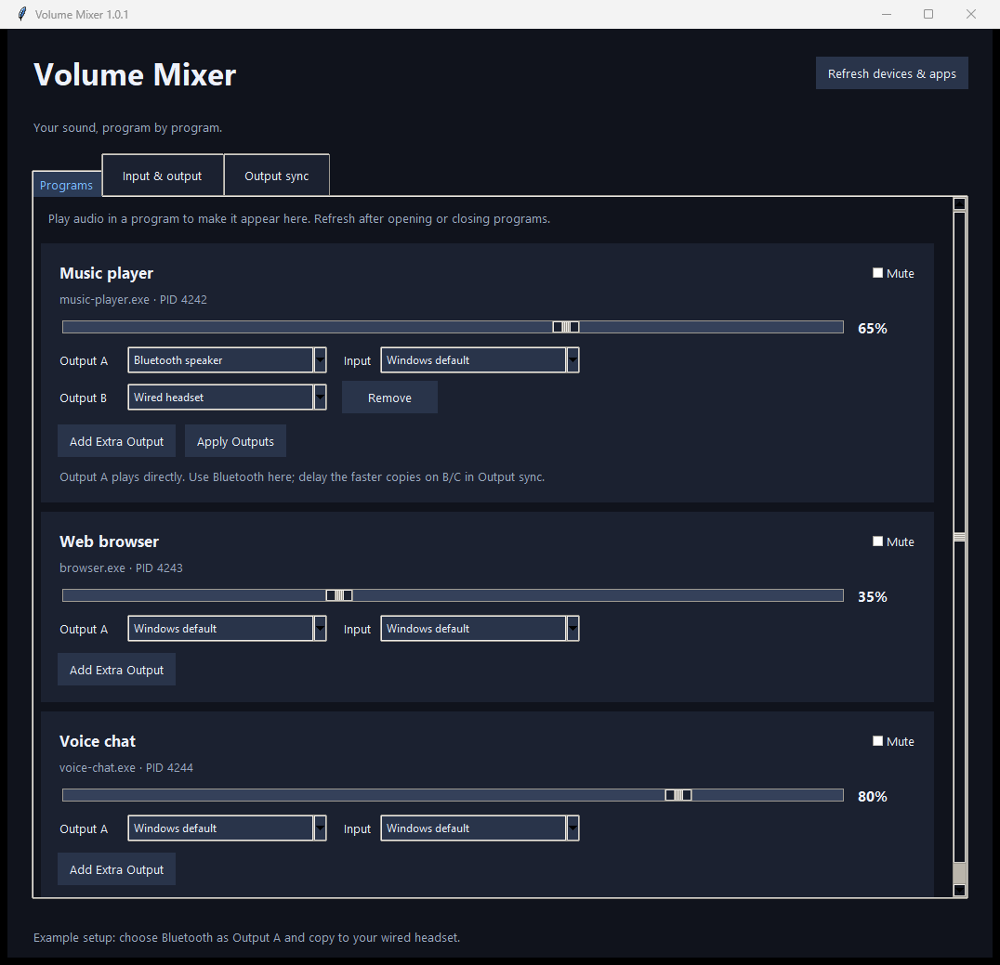
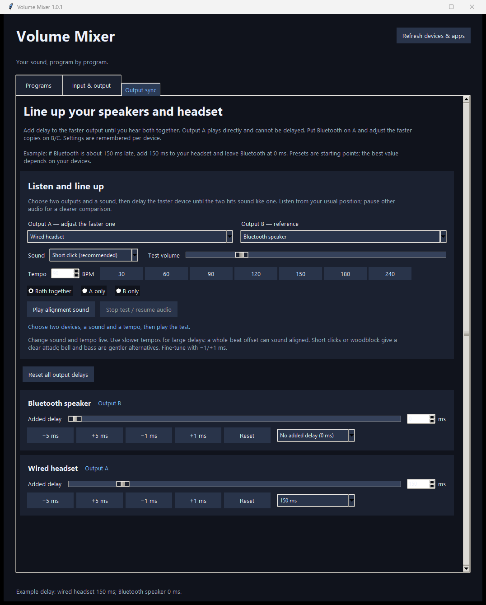

# Volume Mixer

Control each program's volume, choose its audio devices, and share its sound to multiple outputs from one Windows desktop app.

**[Download for Windows x64](https://github.com/magarble/volume-mixer/releases/latest)** | [Report a bug](https://github.com/magarble/volume-mixer/issues/new?template=bug_report.yml) | [MIT licence](LICENSE)

1. Download the `VolumeMixer-1.0.2-windows-x64.zip` asset from the latest release.
2. Extract the ZIP.
3. Open the `VolumeMixer` folder and run `VolumeMixer.exe`.

Keep the whole folder together. Python and extra audio drivers are not required.



*Actual app interface with example programs and devices. Output selections shown are a draft, not active sharing.*

<details>
<summary>See Output sync and the alignment controls</summary>



*Example alignment setup: a wired headset with 150 ms added delay and a Bluetooth speaker with 0 ms.*

</details>

## Features

- Per-program volume and mute, with friendly application names.
- Input/output preferences and device volume controls.
- Share one app to several outputs without a virtual audio driver.
- Saved delays for copied outputs and test sounds to align devices by ear.
- Dark interface with inline output rows and predictable mouse-wheel scrolling.

## Download and run

Download the Windows x64 ZIP from [GitHub Releases](https://github.com/magarble/volume-mixer/releases), extract it, and open `VolumeMixer/VolumeMixer.exe`. Keep the entire folder together. Python and extra audio drivers are not required. The executable is unsigned, so Windows may show a publisher warning.

Release packages include a `.sha256` file. To verify a download in PowerShell, run `Get-FileHash .\VolumeMixer-1.0.2-windows-x64.zip -Algorithm SHA256` and compare it with that file.

Normal controls support Windows 10/11. Multi-output sharing requires Windows build 20348 or later, including Windows 11. See the compatibility notes below.

For development, install Python 3.14.0 (x64, the audited release build environment) on Windows 10/11, then run:

```powershell
powershell -ExecutionPolicy Bypass -File .\run.ps1
```

Build the desktop executable:

```powershell
powershell -ExecutionPolicy Bypass -File .\build.ps1
```

The build runs the automated tests and produces `dist/VolumeMixer/VolumeMixer.exe`, a versioned ZIP, and its SHA-256 checksum in `release/`. Use `build.ps1 -SkipInstall` to reuse an already installed build environment.

## Normal mixing

Start playback in a program and click **Refresh devices & apps**. The Programs tab groups that process's sessions across all active output devices. Adjust its volume, mute it, or choose its output and input devices. **Windows default** clears that program's preference. Some programs explicitly choose their own device or require restarting playback before preferences take effect. System sounds can be adjusted but cannot be routed per process.

Cards show the friendly application name above the executable name and PID. Names come from Windows product metadata, common application/helper names, or the audio-session name, with a readable filename fallback. Separate processes remain separate cards, even if their friendly names match.

The Input & output tab adjusts each physical or virtual endpoint's volume and mute. Microphone volume applies to the microphone device, affecting programs using it. Windows does not expose a universal independent capture-volume slider for every other program.

The mouse wheel scrolls the page without changing dropdown selections or numeric fields. Select devices and presets using the dropdown or keyboard.

Refresh reads current Windows levels. Sliders do not automatically track changes made outside the app. New/closed programs and hotplugged devices appear on refresh. Applications using exclusive audio mode may bypass shared-session controls.

## Play one app on multiple outputs

1. On the application's card, choose your first device in **Output A**. The input selector stays beside it.
2. Click **Add Extra Output** to create **Output B** directly underneath. Pick your second device, such as a Bluetooth speaker. Add further rows for **Output C**, **D**, and so on.
3. Choose Bluetooth as **Output A** and your headset as **Output B**. A plays the program's original audio; the mixer captures only that program and plays copies on B/C. No virtual audio device or extra driver is required.
4. Click **Apply Outputs**. The app opens the extra outputs and application capture, then routes the program to A. Some programs need playback restarted to switch devices.
5. Adjust **Device volume** beneath each output row to change A, B, or any extra output independently. These sliders update the selected Windows device immediately, affecting all audio on that device. The program volume slider above the rows remains separate. Windows default controls the current default output; refresh after changing the Windows default.
6. **Stop sharing** restores the program's previous output preference. Closing the mixer also restores it.

All output configuration stays on the application's card. Extra rows can be removed; labels update automatically. Output selections and unfinished rows survive Refresh during the current app session. Changing a multi-output draft does not alter playback until you click Apply Outputs. Missing or duplicate devices produce an inline message, leaving a valid existing stream playing.

While sharing, edit the rows and apply them to reconfigure that same app. Removing the final extra row stops sharing and routes directly to Output A. A single direct output changes immediately from its dropdown. Sharing uses Windows application loopback capture and supports one application at a time. It requires Windows build 20348 or later, including Windows 11; ordinary volume and routing controls remain available on older versions.

Each output has an independent playback worker with a bounded queue, so a slower output does not hold up the others or accumulate a long backlog. Per-output delay supports manual alignment of Bluetooth and wired devices. Different device clocks and changing wireless latency may require readjustment. A disconnected/failed output stops the bridge and restores the app's original route. One program bridge is supported at a time; all ordinary volume controls remain available.

## Output sync: adjust each device's delay

Open **Output sync**, or use **Adjust output delays** on the currently shared program. Playing outputs appear first. Each output has:

- A **0–1,000 ms** slider, updated live while sharing audio.
- A millisecond entry, plus **−5/+5 ms** and **−1/+1 ms** buttons for coarse and fine adjustment.
- Starting presets at **0, 50, 100, 150, 200, 250, 300, and 500 ms**.
- A per-device **Reset** button and **Reset all output delays**.

Add delay to the faster device. For example, if the Bluetooth speaker sounds 150 ms later than the headset, set the headset to **150 ms** and leave Bluetooth at **0 ms**. Increase or decrease the headset delay until the echo disappears. The preset values are convenient starting points, not measured profiles for particular Bluetooth models or codecs.

Delay is implemented with a bounded audio sample buffer at 48 kHz, independently for each copied output. Output A is direct playback and ignores saved delay settings during sharing. Adjusting the slider changes the delay tap with a short crossfade; it may briefly blend two moments of the audio while you adjust. Initial delay introduces silence until the buffer fills. These controls apply to copied outputs B/C during sharing. Ordinary direct Windows routing uses the destination device's native timing.

Settings are remembered by Windows endpoint ID at `%LOCALAPPDATA%\VolumeMixer\output-delays.json`. If a device is reinstalled and Windows assigns it a new endpoint ID, configure its delay again. Automatic latency measurement and long-term clock synchronization are not implemented.

## Line up outputs by ear

The **Listen and line up** panel in Output sync plays identical test sounds through the same per-output delay buffers used for shared audio.

1. Select **Output A** (usually your faster headset) and **Output B** (usually your slower Bluetooth speaker).
2. Choose a sound and tempo, then click **Play alignment sound**. The default is **Short click** at **90 BPM**. The initial test level is 20%; increase it as needed to hear both devices clearly.
3. Use **A only** and **B only** to identify each output. Switch back to **Both together** for alignment.
4. Listen from your usual position. Adjust the faster output using the slider/5 ms steps, then use the 1 ms buttons to make the double tap sound as close to one tap as possible.
5. Pause and restart the test to re-check your match. Stop with **Stop test / resume audio**. Delay settings stay saved.

Choose **Short click**, **Woodblock**, **Bright ding**, **Soft bell**, **Bass bump**, or **Soft noise burst**. The synthesized sounds have a short attack and tapered ending. Bell/ding provide pitched alternatives; bass bump is a short descending kick-like tone. Short click remains the default for judging closely spaced hits.

Tempo can be set from **30 to 240 BPM**, with presets at **30, 60, 90, 120, 150, 180, and 240 BPM**. At 90 BPM a hit repeats about every 667 ms; 120 BPM gives 500 ms and 240 BPM gives 250 ms. Sound, volume and tempo can all change while the test plays. Tempo changes use a brief settling interval before restarting the beat.

Use a slower tempo when aligning large delays: an offset equal to one whole beat can sound synchronized at fast tempos. Check the result at 30 BPM before keeping it. Both devices receive the same waveform and sample timing; their individual delays still apply. Calibration volume controls the test sound independently.

Standalone testing opens the chosen outputs directly and needs no driver or microphone. Stop sharing and pause the program before running it. The test gives a starting delay; apply outputs again and fine-tune B/C against the program because the copied path adds capture/playback latency that the standalone test does not include. Output A cannot be delayed during sharing: use the slower device (usually Bluetooth) as A. If the copied output is already later at 0 ms, this driver-free design cannot align that device pair.

## Compatibility and validation

Output/input preferences use Windows' internal AudioPolicyConfig interface, with fallbacks for current and older Windows builds. Windows updates may affect compatibility; ordinary volume controls remain usable if routing is unavailable. The interface layout was checked against [EarTrumpet's implementation](https://github.com/File-New-Project/EarTrumpet/tree/master/EarTrumpet/Interop/MMDeviceAPI). Audio endpoints and sessions use [Pycaw](https://andremiras.github.io/pycaw/); per-application capture uses the system COM APIs demonstrated by [Microsoft's application loopback sample](https://learn.microsoft.com/en-us/samples/microsoft/windows-classic-samples/applicationloopbackaudio-sample/), and playback uses [SoundCard](https://soundcard.readthedocs.io/en/latest/).

Run tests with `.\.venv\Scripts\python.exe -m unittest discover -s tests`. Logs are stored at `%LOCALAPPDATA%\VolumeMixer\mixer.log`.

Automated tests cover output drafts, duplicate rejection, primary-versus-copy playback, process-capture startup failures, route restoration, independent delays, and calibration sounds. Run `python smoke_test.py` for Windows UI/routing checks and silent process capture between two physical outputs. Bluetooth synchronization needs listening tests with the speaker connected; varying wireless latency and device clocks may require readjustment. DRM-protected audio and exclusive/offloaded playback may not be capturable.

## Release maintenance

`version.py` is the version source for the window title, Windows executable metadata, and archive name. Update it together with `CHANGELOG.md` and `RELEASE_NOTES.md` for each release.

GitHub Actions tests and packages Windows builds on pushes to `main` and pull requests. Pushing a matching version tag (for example, `v1.0.2`) creates a **draft** release with the ZIP and checksum after the build passes. Run the local Windows smoke test and listen to a wired/Bluetooth device pair before publishing the draft. Hardware tests do not run on hosted CI.

Report problems through [GitHub Issues](https://github.com/magarble/volume-mixer/issues), including the app version, Windows build (`winver`), affected programs/devices, and relevant log excerpts. Remove personal information before posting logs.

## Troubleshooting

| Problem | What to try |
| --- | --- |
| A program is missing | Start playback, then click **Refresh devices & apps**. Refresh again after opening or closing programs. |
| A device change has no effect | Restart playback or the affected program. Check whether it explicitly selects its own audio device. |
| Sharing will not start | Use Windows build 20348 or later, select different connected outputs, and stop any existing sharing or alignment test. Check that no other app holds the output in exclusive mode. |
| A copied output is silent | Check the program's mute/volume and the device's mute/volume. Protected, exclusive, and offloaded audio may not be capturable. |
| Bluetooth and wired sound echo | Put the slower device on Output A. Add delay to the faster copied output in **Output sync**. Re-check at 30 BPM; wireless latency can change. |
| The copy is late even at 0 ms | This device pair cannot be aligned through the current driver-free path: Output A cannot be delayed during sharing. |
| A device disconnects | Reconnect it, refresh, and apply the outputs again. Sharing stops and restores the original route after a detected output failure. |
| Windows shows a publisher warning | The portable executable is currently unsigned. Download from this repository's Releases page and verify the supplied checksum. |

Logs are at `%LOCALAPPDATA%\VolumeMixer\mixer.log`. Include the app version, Windows build from `winver`, device setup, and a relevant log excerpt in a bug report. Remove private paths and other personal information before posting.

## Contributing and licensing

Bug reports, feature ideas, and focused pull requests are welcome. See [CONTRIBUTING.md](CONTRIBUTING.md) for setup, tests, and audio hardware checks.

Volume Mixer's own code is available under the [MIT licence](LICENSE), copyright 2026 magarble. Bundled dependencies keep their original licences; see [THIRD_PARTY_NOTICES.md](THIRD_PARTY_NOTICES.md) and the included `licenses/` folder. Release builds collect these notices automatically.

